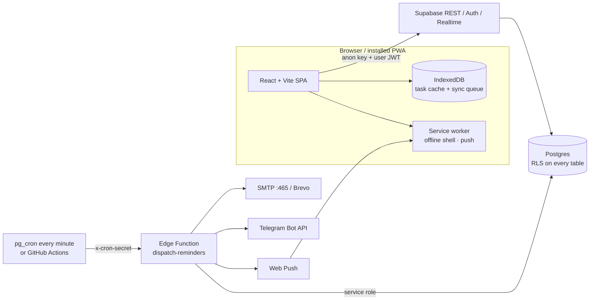

# LAKSHYA · लक्ष्य

**Your Goals. Your Time. Your Journey.**

A personal productivity operating system: calendar, My Day planner, tasks, projects, work, study planner, meetings, notes, goals and habits, focus timer, analytics and multi-channel reminders in one installable web app.

It is built to run at **zero cost** on free tiers: Vercel Hobby, Supabase Free, GitHub, the Telegram Bot API, Web Push, and Gmail SMTP or Brevo.

---

## Contents
1. [Architecture](#1-architecture)
2. [Features](#2-features)
3. [Quick start (local)](#3-quick-start-local)
4. [Supabase setup](#4-supabase-setup)
5. [Environment variables](#5-environment-variables)
6. [Notifications setup](#6-notifications-setup)
7. [Deploy to Vercel](#7-deploy-to-vercel)
8. [Free-tier limits](#8-free-tier-limits--what-happens-when-you-hit-them)
9. [Testing](#9-testing)
10. [Project structure](#10-project-structure)
11. [Security model](#11-security-model)
12. [Known limitations](#12-known-limitations)

---

## 1. Architecture



**Why there is no custom Node server:** Supabase handles auth, data, authorization (RLS), realtime and scheduled server code (Edge Functions plus `pg_cron`). A separate Express server would add hosting cost and attack surface without adding any capability.

**Reminder pipeline.** It is database-backed and idempotent; nothing assumes a function runs continuously.

1. Every run, the dispatcher **plans** jobs for the next ~7 days into `reminder_jobs`. Each job's `idempotency_key` is `type:id:occurrence:offset`. Recurring events are expanded in their own timezone, so they stay correct across DST changes.
2. It **leases** due jobs with `FOR UPDATE SKIP LOCKED`, which is safe under concurrent or overlapping runs.
3. It **delivers** to each enabled channel. Each success is logged, and a unique index allows only one success per job per channel, so retries never double-send.
4. Failures **retry** with exponential backoff (2/4/8/16 min, up to 5 attempts). Jobs more than 2 hours late are marked `skipped` instead of spamming you.
5. Editing, completing or deleting an event, task, meeting, exam, study session or project **cancels** its pending jobs through a trigger. The next run re-plans them. Unchanged keys are revived; changed times get new keys.

## 2. Features

| Area | What's implemented |
|---|---|
| Auth | Register, login, logout, password reset by email link, protected routes, global sign-out, password change |
| Overview | Greeting, live clock, daily progress ring, **Today's Focus** (transparent scoring, with the formula shown in the UI), today's schedule, upcoming 7 days, meetings, active projects, study, goals, a reschedule queue for overdue tasks (manual, never automatic), quick actions |
| My Day | Time-blocked timeline, drag tasks/events/meetings onto slots, free-time and busy-time totals, conflict detection, suggested free slots, daily priorities, unscheduled tray, quick notes with autosave, completion %, prev/next day |
| Calendar | Day / Week / Month / Year / Agenda / Timeline. Create by selecting a range, drag and resize, recurring events (presets + custom RRULE), edit/delete **this / following / all** occurrences, exceptions, all-day, location, meeting link, notes, attachments, reminders, categories with custom colors, tags, priority, history, duplicate, conflict warnings, kind filters, double-submit protection (`client_key`) |
| Tasks | Full CRUD, subtasks, dependencies (blocked tasks rank lower), 4 priorities, 5 statuses, recurring tasks (the next instance is created when you complete one), reminders, tags, List / Kanban (drag) / Calendar / Timeline / Completed-history views, filtering, sorting, search, bulk edit and delete, offline support |
| Projects | Cards, dashboard, automatic or manual progress, milestones, Kanban, timeline, project calendar, progress-over-time chart, notes, links, file attachments, history, deadline countdown |
| Work | Editable weekly working hours per day with office/WFH, weekly overview, daily checklist (carry over unfinished items), office tasks and deadlines, meetings this week, leave and holiday planning |
| Study | Subjects, chapters, spaced revision (1→3→7→14→30→60 days), study sessions (planned → completed with actual minutes), exams and mocks with countdowns and scores, daily and weekly targets, subject and daily charts |
| Meetings | Google Meet / Zoom / Teams auto-detected from the link, participants, agenda, autosaved notes, follow-up tasks, attended/missed, upcoming and history, join button, WhatsApp share |
| Notes | Rich text (TipTap), autosave with a visible status and retry, pin, archive, tags, types, search, links to project / subject / task / meeting / event |
| Goals & Habits | Daily → yearly and custom goals, numeric targets or milestones, habits with custom weekdays, current and best streaks, a 7-day check grid and a 20-week heatmap |
| Focus | Pomodoro (25/5/15 by default, customizable), long break every 4 sessions, task association, fullscreen distraction-free mode, a timer that survives navigation and reload, browser notification and chime, saved session history, daily target |
| Analytics | Custom date range; tasks completed / pending / overdue, projects, scheduled working hours, study time, meetings, goals; daily, weekly and monthly charts, category distribution, project progress, study time, activity heatmap. **Every number states how it is calculated**, and there is no opaque "productivity score". Every chart has a table view. |
| Notifications | In-app center (realtime, unread badge, mark read, history), browser push, email, Telegram, WhatsApp click-to-chat, quiet hours, per-type toggles, daily agenda, weekly summary, delivery log, scheduler health banner |
| Search & shortcuts | `Ctrl/⌘ K` or `/` search everything (with filters), `Q` quick add, `T` new task, `E` new event, `Esc` closes. Shortcuts are ignored while typing. |
| PWA / offline | Installable (manifest, icons, maskable icon), offline app shell, offline task viewing, creating, editing and deleting, a coalescing sync queue, **conflict detection: never overwrites newer server data**, a conflict review screen, connection and pending-sync banner, update prompt |
| Data ownership | Full JSON backup, CSV export of tasks and calendar (with formula-injection protection), transactional restore (all or nothing), delete all data, delete account. All destructive actions use typed confirmations. |
| Design | Custom design system (tokens, light/dark/system theme saved to your account), brand mark and favicon, geometric empty-state art, skeleton loaders, toasts, mobile bottom nav, full-screen sheets on phones, safe-area insets, reduced-motion support |

## 3. Quick start (local)

Prerequisite: Node.js 20 or newer.

```bash
npm install
cp .env.example .env.local      # then fill in values from §4
npm run dev                     # http://localhost:5173
```

Without Supabase credentials the app shows a **"Connect your Supabase project"** screen. It never pretends to work.

## 4. Supabase setup

1. **Create a project** at <https://supabase.com> (free, no card needed). Region: Mumbai (`ap-south-1`) for India.
2. **Run the migrations**, using either method:
   - **SQL Editor:** paste and run, in order, `supabase/migrations/20261112000001_schema.sql`, then `…02_security_and_logic.sql`, then `…03_reminder_worker.sql`.
   - **CLI:**
     ```bash
     npx supabase login
     npx supabase link --project-ref <your-ref>
     npx supabase db push
     ```
3. **Auth settings** (Dashboard → Authentication):
   - **URL Configuration:** set Site URL to your app URL (`http://localhost:5173` while developing, later `https://<app>.vercel.app`). Add both URLs, and `…/reset-password`, to **Redirect URLs**.
   - **Email confirmations and the built-in mailer.** Supabase's default auth mailer only delivers to your project team's addresses and is heavily rate-limited. For a personal app either:
     - turn **Confirm email** off (Providers → Email), or
     - set up **custom SMTP** (Authentication → Emails → SMTP Settings), for example Gmail: `smtp.gmail.com`, port `465`, your address, and a [Google App Password](https://myaccount.google.com/apppasswords) (requires 2-step verification). This is also what makes **password-reset emails** reach you.
4. Copy **Project URL** and the **anon public** key (Settings → API) into `.env.local`.

## 5. Environment variables

**Frontend:** `.env.local` locally, Vercel → Settings → Environment Variables in production. These values are public by design; RLS protects your data.

| Variable | Required | Description |
|---|---|---|
| `VITE_SUPABASE_URL` | yes | `https://<ref>.supabase.co` |
| `VITE_SUPABASE_ANON_KEY` | yes | anon public key |
| `VITE_VAPID_PUBLIC_KEY` | for push | public half from `npm run gen:vapid` |

**Edge Function secrets** (server-side only, never in the frontend or git). Copy `supabase/functions/.env.example` to `supabase/functions/.env`, fill it in, then run `npx supabase secrets set --env-file supabase/functions/.env`.

| Secret | Purpose |
|---|---|
| `CRON_SECRET` | Shared secret the scheduler sends. Generate with `openssl rand -hex 32`. |
| `APP_URL` | Your deployed URL (links in emails, CORS) |
| `VAPID_PUBLIC_KEY`, `VAPID_PRIVATE_KEY`, `VAPID_SUBJECT` | Web Push signing |
| `TELEGRAM_BOT_TOKEN` | optional shared bot (users can bring their own) |
| `EMAIL_PROVIDER` | `smtp` or `brevo` |
| `EMAIL_FROM`, `SMTP_HOST`, `SMTP_PORT`, `SMTP_USER`, `SMTP_PASS` | SMTP (port **465**) |
| `BREVO_API_KEY` | Brevo transactional API |

`SUPABASE_URL` and `SUPABASE_SERVICE_ROLE_KEY` are injected into Edge Functions automatically. **Never** put the service-role key anywhere else.

## 6. Notifications setup

### 6.1 Deploy the functions

```bash
npx supabase functions deploy dispatch-reminders --no-verify-jwt
npx supabase functions deploy notify-test
npx supabase functions deploy delete-account
```

### 6.2 Schedule the dispatcher (pick one)

**A. `pg_cron` (recommended, every minute, free).** Open `supabase/sql/schedule_cron.sql`, replace the project URL and `CRON_SECRET` placeholders, and run it in the SQL Editor. The secrets are stored in Supabase Vault, not in the job text.

**B. GitHub Actions (fallback).** `.github/workflows/reminders.yml` runs every 10 minutes. Add the repository secrets `SUPABASE_URL` and `CRON_SECRET`. Caveats:
- the minimum interval is 5 minutes, and runs are often delayed 5–15 minutes;
- private repos get 2,000 minutes/month, so use `*/30` there;
- scheduled workflows are disabled after 60 days without repository activity.

The **Notifications** page shows when the scheduler last ran and warns if it looks stopped.

### 6.3 Channels

| Channel | Setup | Notes |
|---|---|---|
| In-app | nothing | Always works, including during quiet hours |
| Browser push | `npm run gen:vapid`, set the keys (§5), then Settings → Integrations → Enable | Delivered when the browser is closed if the OS allows it. **iPhone/iPad:** iOS 16.4+ and only after *Add to Home Screen*. |
| Email | Set `EMAIL_PROVIDER` and its credentials; enter your address in Settings | Gmail: `smtp.gmail.com:465` with an App Password (~500 recipients/day). Brevo: 300 emails/day free, verify a single sender (no domain needed). **Edge Functions block ports 25 and 587**, so use 465. |
| Telegram | Talk to @BotFather to create a bot, message it once, get your chat id from @userinfobot, then Settings → Telegram | Token and chat id are stored in `integration_secrets`, which no client can read |
| WhatsApp | optional default number in Settings | **Click-to-chat only.** It opens WhatsApp with the message prefilled, and *you* press send. Automatic WhatsApp delivery requires the paid Business API, so it is deliberately not implemented. |

## 7. Deploy to Vercel

1. Push the repo to GitHub.
2. In Vercel: **New Project**, import the repo. The framework preset is detected (`vercel.json` included).
3. Add the `VITE_*` variables and deploy. The free `*.vercel.app` URL is all you need, with no domain purchase.
4. Put the deployed URL into Supabase Auth's Site URL and Redirect URLs, and into the `APP_URL` secret.

## 8. Free-tier limits & what happens when you hit them

> These figures are a snapshot. Check the providers' pricing pages: [Supabase](https://supabase.com/pricing), [Vercel](https://vercel.com/pricing), [GitHub Actions](https://docs.github.com/en/billing/managing-billing-for-github-actions/about-billing-for-github-actions), [Brevo](https://www.brevo.com/pricing/).

| Service | Free limit (approx.) | LAKSHYA usage / mitigation |
|---|---|---|
| Supabase DB | 500 MB | Text-only rows; the scheduler prunes old jobs (30 d), logs (90 d), read notifications (90 d) and activity history (365 d). One person's data stays small for years. |
| Supabase Storage | 1 GB total | Attachments are capped at 10 MB each. Uploads past the quota show a clear "storage quota reached" error. |
| Supabase egress | 5 GB / month | All views query date ranges, never the whole database |
| Edge Functions | 500K invocations / month | Every-minute cron ≈ 43K/month |
| **Project pausing** | Free projects are **paused after ~7 days of inactivity** | Use the app weekly, or rely on the cron/Actions traffic. If paused, restore it from the dashboard (data is kept). |
| **Backups** | **No automatic backups** on Free | Use Settings → Data → *Full backup (JSON)* regularly. LAKSHYA does not claim automatic backups exist. |
| Realtime | 200 concurrent connections | One per open tab |
| Vercel Hobby | Personal / non-commercial use, ~100 GB bandwidth | Static SPA. The service worker caches assets. |
| GitHub Actions | Public repos: free. Private: 2,000 min/month. | Only needed if you skip `pg_cron` |
| Gmail SMTP / Brevo | ~500/day / 300/day | Reminders are short; failures are logged and retried, and other channels still deliver |

**Graceful degradation.** If a provider fails or a quota is hit:
- that channel's delivery is logged as `failed` (visible under Notifications → Delivery log) and retried with backoff;
- the other channels and in-app notifications still deliver;
- the app itself keeps working, and offline task edits queue until the connection returns.

## 9. Testing

```bash
npm test                # 43 unit + integration tests (Vitest)
npm run test:e2e        # Playwright UI smoke test (needs: npx playwright install chromium)
npm run check:functions # deno check + Deno runtime check for Edge Functions (needs Deno, or use npx deno)
npm run build           # type-check + production build
```

What is covered:
- **Database (`supabase/tests/db.test.ts`):** the real migrations run inside **PGlite** (Postgres compiled to WASM) with stand-ins for Supabase's `auth` and `storage` schemas. Tests cover RLS user isolation, forged `user_id` rejection, cross-user foreign-key blocking, anon denial, secret-table invisibility, worker functions being inaccessible to clients, recurring-task spawning (exactly once), auto project progress, reminder cancellation on edit, `SKIP LOCKED` job leasing, activity history, timezone validation, scoped search, transactional import with rollback, and delete-all-data.
- **Shared logic:** timezone and DST math, quiet hours, RRULE expansion across DST, exceptions and exdates, series splitting, idempotency keys, digest scheduling.
- **App logic:** focus ranking, conflicts, free slots, habit streaks, backup ID remapping, CSV escaping, offline queue coalescing.
- **UI smoke (`e2e/smoke.mjs`):** the production build runs in Chromium against a mocked Supabase. Every page is visited at 1440 px and 390 px. The test fails on runtime errors or horizontal overflow, and also checks keyboard shortcuts, search, form validation and protected-route redirects. Screenshots go to `e2e/screenshots/`.

**Not yet verified against a live Supabase project:** real sign-up and confirmation emails, password-reset emails, actual push/Telegram/email delivery, and `pg_cron`. These need your project credentials. Use Settings → Integrations → *Test* for each channel after setup.

## 10. Project structure

```
src/
  components/      ui/ (Button, form, Modal, display, feedback, pickers) · charts.tsx · brand/
  features/        calendar · tasks · meetings · projects · notes · notifications · search · pwa · attachments
  layouts/         AppLayout (sidebar, top bar, mobile nav) · nav.ts
  lib/             supabase, dates (tz-aware), planning (rule-based automation), backup, constants, utils
  offline/         IndexedDB store + sync queue with conflict detection
  pages/           one file per route
  providers/       Auth, Theme, AppData (settings), Sync, Focus, QuickCreate, Confirm
  services/        resource.ts (generic typed CRUD) · tasks.ts (offline-capable) · calendar.ts (feed + recurrence edits)
  types/db.ts      row types
  sw.ts            service worker
supabase/
  migrations/      schema · RLS/triggers/RPCs · worker helpers
  functions/       dispatch-reminders · notify-test · delete-account · _shared (pure TS, also used by the web app)
  sql/             schedule_cron.sql (run once, contains your secrets → not a migration)
  tests/           PGlite database tests
e2e/               Playwright smoke test
scripts/           gen-vapid, gen-icons
```

## 11. Security model

- **RLS on every user table.** Policies compare `user_id` with `auth.uid()` from the verified JWT. The client never chooses whose data it touches.
- **Composite foreign keys `(id, user_id)`** make it impossible to link a row to another user's project, task or meeting, even with a guessed UUID.
- **Least privilege.** `anon` has no table access. Clients cannot insert or update reminder jobs, delivery logs, activity history or integration status. `integration_secrets` has RLS enabled with no policies and revoked grants. Worker RPCs are revoked from clients.
- **Secrets are server-only:** the service-role key, SMTP password, VAPID private key and bot tokens. The scheduler authenticates with a constant-time-compared `CRON_SECRET`.
- **Input validation** happens in Zod on the client and again through Postgres `CHECK` constraints, enums, length limits, URL checks and IANA-timezone validation.
- **Safe errors.** Database errors are mapped to friendly messages. Password-reset requests never reveal whether an account exists.
- **XSS and other injection.** No `dangerouslySetInnerHTML`. Rich text goes through ProseMirror's schema. External links are restricted to http(s) with `rel="noopener noreferrer"`. CSV exports neutralise formula injection.
- **Rate limiting.** The test-notification endpoint allows 10 per hour per user. Auth endpoints use Supabase's built-in limits.
- **Headers** (`vercel.json`): `X-Frame-Options: DENY`, `nosniff`, `Referrer-Policy`, `Permissions-Policy`.

## 12. Known limitations

These are deliberate trade-offs to stay free and reliable:
- **Offline mode covers tasks** (view, create, edit, complete, delete). Other modules need a connection and say so through the offline banner.
- **Recurring tasks** use simple rules (daily, weekdays, weekly, biweekly, monthly, yearly). Recurring **events** support full RRULE.
- **Quiet hours** hold back push, email and Telegram for reminders that fire inside the window; those reminders are not re-sent later. In-app notifications are still recorded.
- **Chapter revision due-dates** appear in the Study Planner; they are not pushed as notifications.
- **WhatsApp** is click-to-chat only (see §6.3).
- The **Timeline** views are custom-built, because FullCalendar's resource timeline is a paid Premium plugin.
- The Edge Functions use `npm:web-push` and `npm:nodemailer` through Deno's npm compatibility. They type-check and load under Deno 2, but run the *Test* buttons after deploying to confirm on Supabase's runtime.
# LAKSHYA

